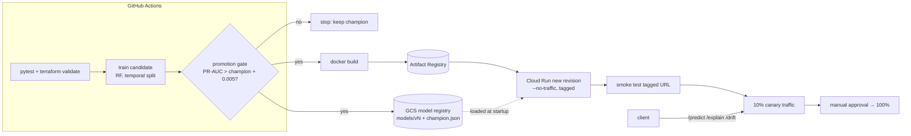

# Driver Cancellation Risk: MLOps Pipeline on Cloud Run

Productionizes the model from my UCF research on **strategic driver cancellations in quick commerce**
([research repo](https://github.com/anuragelluruucf/Micro-Economic-Reserach-on-Driver-cancellations-in-Quick-commerce-sector)):
a Random Forest + SHAP risk model, now with automated training, a **champion/challenger promotion gate**,
a versioned model registry (local + GCS), an explainable FastAPI service, input-drift checks, Terraform for
GCP, and a GitHub Actions pipeline that ships new models as a **Cloud Run canary**.

**Highlights:** 8 automated tests (pipeline, gate, drift, API) · ~25 ms `/predict` latency · one-command GCP deploy with Terraform · keyless CI/CD via Workload Identity Federation.

**Live demo:** https://driver-cancel-risk-ty5y6wq2hq-uc.a.run.app ([health](https://driver-cancel-risk-ty5y6wq2hq-uc.a.run.app/health) · [interactive API docs](https://driver-cancel-risk-ty5y6wq2hq-uc.a.run.app/docs)), running on Cloud Run (scales to zero, so the first request may take a few seconds).

```bash
curl -X POST https://driver-cancel-risk-ty5y6wq2hq-uc.a.run.app/predict -H 'content-type: application/json' \
  -d '{"lifetime_order_count":40,"bike_issue_rate":0.6,"post_pickup_rate":0.8,"total_distance":9.5,"first_mile_distance":2.5,"last_mile_distance":7.0,"session_time":300,"hour":19,"time_to_accept":1.0,"time_to_pickup":10}'
```

> **About the data:** the original research used a proprietary dataset of 447,187 orders, so this repo trains on a
> synthetic sample (`src/data.py`) with the same 13-feature schema. Swap in a BigQuery extract to train on real data.

## Architecture

Auth from GitHub to GCP uses **Workload Identity Federation** (no JSON keys). The runtime service account
only has `storage.objectViewer` on the model bucket.

## Quick start
```bash
make            # venv + deps, synthetic data, train, gate, tests
make serve      # API on :8080   (in another shell:)  make smoke
make tf-check   # terraform fmt + validate
```
| Endpoint | Purpose |
|---|---|
| `GET /health` | status + serving model version |
| `POST /predict` | risk score + tier (low / medium / high, from the research's policy simulation) |
| `POST /explain?top_k=5` | top SHAP feature contributions for one order |
| `POST /drift` | PSI per feature for a batch (≥ 50 orders) vs. training reference; `src/drift.py` does the same from a CSV |

## Layout
`src/data.py` synthetic generator · `src/features.py` schema · `src/train.py` training + registry write ·
`src/gate.py` promotion gate · `src/registry.py` local/GCS registry · `src/drift.py` PSI ·
`app/main.py` FastAPI · `terraform/` Cloud Run v2, Artifact Registry, versioned GCS bucket, least-privilege SA ·
`.github/workflows/mlops.yml` test → train → gate → build → canary → promote.

## Results (measured locally, synthetic data, Oct 20, 2026)
Test split: last 30% of 60,000 synthetic orders (18,000), positive rate 1.10%.

| Model | PR-AUC | ROC-AUC | Gate decision |
|---|---|---|---|
| v1 baseline (10 trees, depth 2) | 0.0609 | 0.7500 | promoted (no champion) |
| v2 research settings (100 trees, depth 8) | 0.0798 | 0.7528 | **promoted** (+0.0189 PR-AUC) |
| v3 identical retrain | 0.0798 | 0.7528 | **rejected** (+0.0000 < 0.005) |

- Drift check: an independent synthetic batch showed no drift; a batch with distance ×1.8 and all orders at 19:00 was flagged (`total_distance` PSI 1.21, `hour` PSI 9.11).
- `/predict` latency: ~25.6 ms average over 200 sequential local requests (laptop-class box, includes HTTP round trip).
- Training time: ~0.6 s for the research-settings model on 42,000 rows.
- 8 automated tests pass (pipeline, gate, drift, API).

Why PR-AUC: positives are ~1% of orders, and PR-AUC reflects rare-class performance better than ROC-AUC.

## Why it's built this way
- **Trained on the past, tested on the future.** The model learns from older orders and is scored on newer ones, the same way it would be used in real life.
- **A new model only goes live if it's clearly better.** It has to beat the current model by a set margin, so small random changes don't keep swapping models.
- **New versions roll out gradually.** A new version is checked first, then gets 10% of traffic, and only goes to everyone once it looks healthy. Undoing a bad release takes one command.
- **The pipeline owns releases.** After the first setup, GitHub Actions handles every new version, so the infrastructure code doesn't fight it.

## How it runs on Google Cloud
It's live today on Cloud Run (link at the top). Every push to `main` runs the tests, retrains the model and compares it with the current one. If the new model wins, it ships automatically. GitHub signs in to Google Cloud without any stored passwords or keys. To run your own copy, create a GCP project, add the three GitHub settings the workflow uses, and run `terraform apply` in `terraform/`.

## What's next
- Store the infrastructure state in the cloud so it isn't tied to one machine.
- Train on real order data from BigQuery instead of the synthetic sample.
