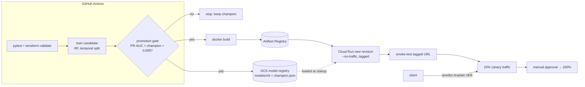

# Driver Cancellation Risk: MLOps Pipeline on Cloud Run

Productionizes the model from my UCF research on **strategic driver cancellations in quick commerce**
([research repo](https://github.com/anuragelluruucf/Micro-Economic-Reserach-on-Driver-cancellations-in-Quick-commerce-sector)):
a Random Forest + SHAP risk model, now with automated training, a **champion/challenger promotion gate**,
a versioned model registry (local + GCS), an explainable FastAPI service, input-drift checks, Terraform for
GCP, and a GitHub Actions pipeline that ships new models as a **Cloud Run canary**.

> **Status:** built and tested locally. **Not deployed** to GCP and not yet run on GitHub Actions.
>
> **Data:** the original research used a *proprietary* dataset of 447,187 orders that is not public.
> This repo trains on a **clearly labeled synthetic sample** (`src/data.py`) with the same feature schema
> (13 features from `strategic_prediction_models.py`). Metrics below describe the pipeline on synthetic
> data, **not** the real-world model.

## Architecture

Auth from GitHub to GCP uses **Workload Identity Federation** (no JSON keys). The runtime service account
only has `storage.objectViewer` on the model bucket.

## Quick start
```bash
make            # venv + deps, synthetic data, train, gate, tests
make serve      # API on :8080   (in another shell:)  make smoke
make tf-check   # terraform fmt + validate
```
| Endpoint | Purpose |
|---|---|
| `GET /health` | status + serving model version |
| `POST /predict` | risk score + tier (low / medium / high, from the research's policy simulation) |
| `POST /explain?top_k=5` | top SHAP feature contributions for one order |
| `POST /drift` | PSI per feature for a batch (≥ 50 orders) vs. training reference; `src/drift.py` does the same from a CSV |

## Layout
`src/data.py` synthetic generator · `src/features.py` schema · `src/train.py` training + registry write ·
`src/gate.py` promotion gate · `src/registry.py` local/GCS registry · `src/drift.py` PSI ·
`app/main.py` FastAPI · `terraform/` Cloud Run v2, Artifact Registry, versioned GCS bucket, least-privilege SA ·
`.github/workflows/mlops.yml` test → train → gate → build → canary → promote.

## Results (measured locally, synthetic data, Oct 20, 2026)
Test split: last 30% of 60,000 synthetic orders (18,000), positive rate 1.10%.

| Model | PR-AUC | ROC-AUC | Gate decision |
|---|---|---|---|
| v1 baseline (10 trees, depth 2) | 0.0609 | 0.7500 | promoted (no champion) |
| v2 research settings (100 trees, depth 8) | 0.0798 | 0.7528 | **promoted** (+0.0189 PR-AUC) |
| v3 identical retrain | 0.0798 | 0.7528 | **rejected** (+0.0000 < 0.005) |

- Drift check: an independent synthetic batch showed no drift; a batch with distance ×1.8 and all orders at 19:00 was flagged (`total_distance` PSI 1.21, `hour` PSI 9.11).
- `/predict` latency: ~25.6 ms average over 200 sequential local requests (laptop-class box, includes HTTP round trip).
- Training time: ~0.6 s for the research-settings model on 42,000 rows.
- 8 automated tests pass (pipeline, gate, drift, API).

Why PR-AUC: positives are ~1% of orders, and PR-AUC reflects rare-class performance better than ROC-AUC.

## Design decisions
- **Temporal split** (as in the research code) avoids training on the future.
- **Gate margin (0.005)** prevents churn from noise-level "improvements".
- **No-traffic tagged revision → smoke test → 10% canary → manual 100%** keeps rollback to one `update-traffic` command.
- Terraform ignores image/traffic drift because CI owns revisions after the first apply.

## Deploying to GCP
1. Create a GCP project and a Workload Identity Federation pool/provider for this repo.
2. In GitHub, set the repo variable `GCP_PROJECT_ID` and the secrets `GCP_WIF_PROVIDER` and `GCP_DEPLOY_SA`.
3. Run `terraform init && terraform apply` in `terraform/` to create Cloud Run, Artifact Registry, the model bucket and the service account.
4. Push to `main`: CI trains, gates, builds the image and rolls out a 10% canary.

## Roadmap
- Remote Terraform state in a GCS backend
- Train on real data via a BigQuery extract instead of the synthetic generator
